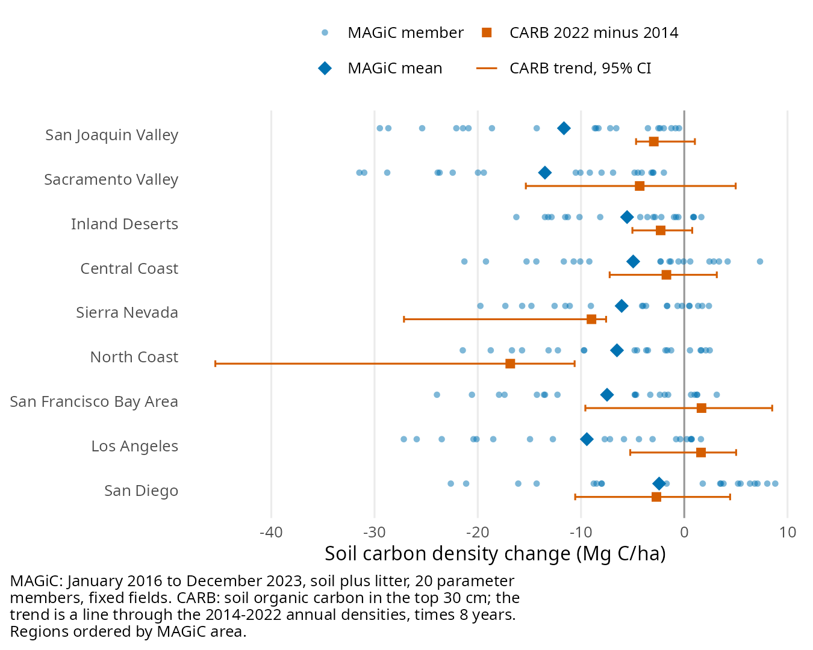

## What this compares

This page compares the MAGiC historical inventory with CARB's cropland carbon
inventory at the state level and for CARB's nine regions
([organization#226](https://github.com/ccmmf/organization/issues/226), with the
CARB values listed in
[organization#228](https://github.com/ccmmf/organization/issues/228)). MAGiC
v0.1.0 is a review candidate. It covers 385,234 fields and 3.49 million
hectares; another 9,679 fields (41,261 ha) are left out because covariates were
missing, so its totals cover those fields rather than all of California's
cropland, and the set of fields does not change over the run. Its soil carbon is
SIPNET soil plus litter carbon (`TotSoilCarb`) and its biomass is standing
aboveground biomass (`AGB`, plant wood plus leaf carbon), both as December 2023
monthly means, with the change from January 2016. MAGiC values are summarized
over the 20 parameter members. N₂O and CH₄ are not in this release yet.

The CARB numbers are copied from the data behind the cropland figures of the
2025 inventory's Supplementary Document C, and from the totals listed in
organization#228. CARB defines cropland soil carbon as the organic carbon in the
top 30 cm of soil, and cropland biomass as the carbon in the roots, trunks and
branches of woody perennial crops; annual crop biomass is not counted (CARB
methods document, January 2025, attached to organization#228). Units are kept
as published, million metric tons of carbon (MMT C) and acres; acres are
converted to hectares for areas and densities.

CARB's totals change with cropland area, which grew over 2014–2022, while
MAGiC's cover a fixed set of fields. Changes are therefore compared per
hectare, and CARB's 2014–2022 years are summarized together instead of picking
single end years, since its annual soil totals move by several MMT C from year
to year.

## Results



{#fig-inventory width=85% fig-alt="Two panels. Soil carbon: the CARB series runs between about 209 and 264 MMT C from 2001 to 2022; MAGiC is 238 in January 2016 and 201 in December 2023. Biomass carbon: CARB rises from 35 to 65 MMT C; MAGiC woody perennial biomass is 10.7 in January 2016 and 1.15 in December 2023."}

## What stands out

**MAGiC loses more soil carbon per hectare than CARB.** On its fixed fields
MAGiC falls from 68.4 to 57.7 Mg C/ha between January 2016 and December 2023, a
loss of 10.7 Mg C/ha (16%). Every one of the 20 parameter members loses soil
carbon, but by very different amounts: the median member loses 25.9 MMT C and
the range is 0.5 to 95 MMT C, so the size of the loss depends strongly on the
parameters. CARB's soil carbon density also falls over 2014–2022, in 7 of its 9
regions, but by less: 3.0 Mg C/ha in the San Joaquin Valley and 4.3 Mg C/ha in
the Sacramento Valley, where most cropland is. CARB's statewide total shows no
clear trend (+0.50 MMT C per year, 95% CI −1.67 to 2.67) because cropland area
grew by 0.27 Mha over the same years.

**The starting soil carbon stocks agree, but not independently.** MAGiC starts
in January 2016 at 238 MMT C, 8.6% above CARB's 2014–2022 mean of 219.5. The
MAGiC soil initial conditions come from the SoilGrids 0–30 cm soil carbon map,
and CARB's 2018 inventory value (245.09 MMT C in the top 30 cm of mineral soil)
was also initialized from SoilGrids, so this agreement is expected and does not
test the model.

**Perennial crop biomass is far below CARB's and falls over the run.** MAGiC
woody crops hold 6.4 Mg C/ha in January 2016 and 0.7 Mg C/ha in December 2023,
against CARB's 34.2 Mg C/ha in 2016 and 33.9 in 2022. CARB's perennial density
is flat; its total rises by 5 MMT C only because perennial area grew from 1.74
to 1.90 Mha. CARB counts roots and not leaves while MAGiC counts leaves and not
roots, but roots cannot close a gap of about fifty times. The modeled orchards
and vineyards hold almost no wood, which points to the woody pools in the
initial conditions and in the run, not to a difference in what the two
inventories count.

**Annual crops start the run with a canopy.** They hold 4.0 Mg C/ha of
standing biomass in January 2016, when winter fields should be close to bare.
This is consistent with the initial-condition problem fixed in
[organization#296](https://github.com/ccmmf/organization/issues/296) after this
inventory was run.

## By region

CARB reports cropland soil carbon density change for nine regions, those of
California's Fifth Climate Change Assessment (CARB 2025 inventory, Appendix B,
Regional Assessment). The regions cut across county lines, so each MAGiC county
is split among regions by the share of its CARB cropland in each region over
2014–2022, taken from CARB's
[aggregated inventory data table](https://ww2.arb.ca.gov/sites/default/files/2026-04/NWL_Carbon_Inventory_2025_aggregated_data_table.xlsx),
which reproduces CARB's published regional density changes to within 0.1
Mg C/ha. Four counties are split: Riverside (67% of its cropland in the Inland
Deserts), San Bernardino (55% in the Los Angeles region), Solano (83% in the
Sacramento Valley) and Mono (52% in the Sierra Nevada). Every other county has
at least 95% of its cropland in one region; Los Angeles County's is 95% in the
Inland Deserts region and Ventura's 97% in the Central Coast. Within each parameter member, a region's MAGiC change is the
total change over its counties and both crop strata divided by their area; the
table summarizes the 20 members. CARB's published change is 2022 minus 2014
(Appendix Figure 70). Its annual regional densities move from year to year, so
the table also gives the trend through all nine years, times eight years.

Soil carbon density change by region, in Mg C/ha, with regions ordered by MAGiC
area. MAGiC is January 2016 to December 2023; CARB is 2022 minus 2014 and the
2014–2022 trend. Areas are MAGiC's field area and CARB's mean cropland area over
2014–2022.



{#fig-regions width=85% fig-alt="Dot plot of soil carbon density change for nine regions. In the San Joaquin and Sacramento valleys all MAGiC members lose soil carbon, with mean losses of 11.7 and 13.5 Mg C/ha against CARB's 3.0 and 4.3. In each of the other regions MAGiC members spread from losses of more than 15 Mg C/ha to gains. CARB's largest losses are in the North Coast and Sierra Nevada, and it gains in the San Francisco Bay Area and Los Angeles regions."}

**In the Central Valley MAGiC loses more soil carbon than CARB.** The
Sacramento and San Joaquin valleys hold 76% of MAGiC's field area, and every
member loses soil carbon in both: 13.5 Mg C/ha on average in the Sacramento
Valley and 11.7 in the San Joaquin Valley (median members 9.6 and 8.4), against
CARB's 4.3 and 3.0. In the San Joaquin Valley CARB's trend interval (−4.7 to
1.0 Mg C/ha over eight years) excludes the median MAGiC member, so the
difference holds there. In the Sacramento Valley CARB's annual density moves
between 68.9 and 84.3 Mg C/ha, and its trend interval (−15.3 to 5.0) is wide
enough to include the MAGiC mean.

**Outside the valleys the two inventories do not line up, and they cover
different land.** MAGiC members disagree on the direction there: between 9 and
16 of the 20 lose soil carbon in each of the other seven regions. CARB's density
rises in the San Francisco Bay Area (1.7 Mg C/ha) and Los Angeles (1.6) regions,
where the MAGiC mean falls by 7.5 and 9.4, although CARB's trends there are
close to zero (−0.5 and −0.1). CARB's largest losses are in the North Coast
(16.9) and Sierra Nevada (9.0), more than MAGiC's 6.5 and 6.1. But in those two
regions MAGiC's field area is 1.7 and 2.3 times CARB's cropland area, so much of
what MAGiC models there is land CARB does not count as cropland, and CARB's
North Coast density ranges from 88.7 to 122.1 Mg C/ha between years.

**Woody crop biomass falls in every region.** Every member loses woody biomass
in every region, from regional means of 5.0 to 24.6 Mg C/ha in January 2016 to
0.4 to 2.4 Mg C/ha in December 2023. In the San Joaquin Valley, which holds 70%
of MAGiC's woody area, it falls from 5.9 to 0.7 Mg C/ha. The loss of wood
described above is not confined to one region.

Limits of the regional comparison:

- **Time.** MAGiC is January 2016 to December 2023; CARB's regional change is
  2022 minus 2014. Both span eight years, but they overlap only over 2016–2022.
- **Area.** MAGiC's fields are fixed, while CARB's cropland grew in every region
  over 2014–2022 (Appendix Figure 63), so CARB's regional density also changes
  as land enters and leaves cropland. MAGiC's field area ranges from 0.5 times
  CARB's cropland area (San Diego) to 2.3 times (Sierra Nevada).
- **Pools and depth.** As for the state: MAGiC soil carbon is soil plus litter
  initialized from the SoilGrids 0–30 cm map; CARB's is soil organic carbon in
  the top 30 cm.
- **County split.** Fields in a split county are assumed to be spread like
  CARB's cropland and to share the county's density. Placing each county wholly
  in the region holding most of its cropland instead changes a region's MAGiC
  mean by at most 0.6 Mg C/ha (Los Angeles).
- **Missing fields.** Every county with CARB cropland in 2014–2022 has MAGiC
  fields, but Alpine, Plumas and Sierra counties have no MAGiC woody fields.
  The 9,679 fields left out of MAGiC for missing covariates are not in its
  county tables, so their regions are unknown. CARB cropland with no county (at
  most 236 acres in a year) is left out of the split.

## Comparability

- **Pools and depth.** CARB soil carbon is the organic carbon in the top 30 cm.
  MAGiC soil carbon is the SIPNET soil plus litter pools, with no depth inside
  the model; its initial stock comes from the SoilGrids 0–30 cm map, so it is
  anchored to the same depth. The v0.1.0 provenance lists its initial-condition
  source as partly unresolved, so this assumes the standard initial-condition
  build. CARB's methods-text value (245.09 MMT C) comes from its 2018 inventory,
  and Appendix Figure 59 from the 2025 inventory; they are different editions.
- **Area.** MAGiC's fields are fixed over the run; CARB's cropland area changes
  from year to year. MAGiC woody crops cover 1.68 Mha; CARB perennial cropland
  covers 1.74 to 1.90 Mha over 2016–2022. CARB's annual cropland area is not in
  the figure data.
- **Time.** MAGiC compares January 2016 with December 2023 monthly means, eight
  years. CARB gives annual estimates; its regional changes are for 2014–2022,
  its biomass is interpolated in some years, and in 2014 it switched orchard
  acreage from NASS to the DWR crop map.
- **Biomass.** MAGiC biomass is standing aboveground wood and leaf carbon at a
  December end point. CARB biomass is woody perennial roots, trunks and
  branches, with no leaves and no annual crops.
- **Uncertainty.** MAGiC spreads are across parameter members only. The CARB
  figure data give an uncertainty only for 2022 perennial biomass (95%
  intervals, Appendix Figure 65).
- **Release status.** v0.1.0 is a review candidate; its provenance manifest
  lists the initial-condition and covariate sources as partly unresolved.

## Next steps

- Find out why the modeled woody crops lose their wood, starting with the
  management events and the initial wood carbon of the woody design points.
- Rerun the inventory with the organization#296 initial conditions, then
  compare again.
- Add N₂O and CH₄ when MAGiC releases them: CARB lists 22.8 Gg N₂O per year for
  cropland and about 0.9 MMT CO₂e per year of rice methane, and the project's
  practice-change evidence workbook already holds rice methane estimates from Hu
  et al. (2026) and CARB.

## Reproducibility

The [frozen inputs](data/inventory/manifest.json) record the source of each file
and its checksum: the MAGiC v0.1.0 state tables and by-member county tables
from `s3://carb/inventories/v0.1.0/2023/` (their checksums match the release),
the CARB values extracted with
[`extract_carb_appendix_c.R`](R/extract_carb_appendix_c.R), CARB's cropland
area and soil carbon by county, region and year extracted from its aggregated
data table with [`extract_carb_regions.R`](R/extract_carb_regions.R), and the
organization#228 totals. Run
`Rscript reports/R/build_inventory_comparison.R` from the repository root, then
`quarto render reports/inventory_comparison.qmd`. The build stops if an input
changes or if one of the main numbers quoted on this page no longer holds. No
model is run.
